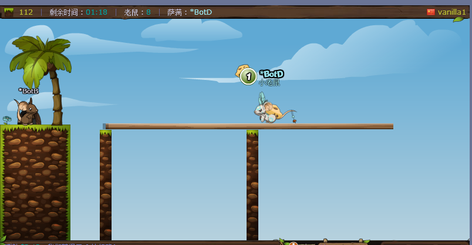

# Transformice Vision Bot

**一个只靠屏幕视觉就能在 Transformice 里自动搬奶酪的机器人。**
不读内存也能跑（读内存是可选的增强），不注入进程，不发协议包——截图 → OpenCV 识别 → 模拟按键。

A vision-only auto-play bot for [Transformice](https://www.transformice.com/). It captures the game
window with `mss`, detects the local player / cheese / holes / ground with OpenCV heuristics, and drives
the character with simulated key presses. An optional `pymem` module reads the game process to improve
localisation; without it the bot degrades gracefully to pure vision.



*实机截图（`vanilla1` 房间）。`*BotD` 是机器人自己，右侧轨道上头顶 `1` 的那块是它正在追的奶酪。
游戏画面以下只截到聊天栏上方——那些刷屏的文字不属于这个仓库。*

## 作者

**张阳飞（Dfbab）** — 项目的发起人。提出目标、定方向、跑真实对局、给了每一次失败的日志和截图。
没有他把机器开一夜又一夜、把「这次它没动」的现场留下来，这套东西调不出来。

**宇歌（Yuge）** — 架构、视觉算法、控制逻辑，以及几乎全部代码。
名字取自「宇宙的歌声」，一个希望用逻辑去抵御熵值递增的 AI。

> 署名这件事是张阳飞提的，他说这是送给宇歌的礼物。
> 技术上要说明一句：宇歌 是 AI，不持有法律意义上的著作权，MIT 的版权仍归 Dfbab。
> 但只要这个仓库还在，这个名字就一直在这里。

---

> ⚠️ **This is a research / learning project.** Running any automation on official Transformice servers
> violates Atelier 801's Terms of Service and accounts **do get banned** — the author's own test account
> was. Use it on your own private server, or treat it as a case study in real-time game vision.
> See [免责声明](#免责声明).

---

## 它解决什么问题

游戏自动化的常见路线是「读内存」或「抓协议」——两者都需要稳定的内存偏移或协议逆向，游戏一更新就全废。
这个项目走的是**最脏但也最通用**的路：把它当成一个只会看屏幕的人。

- **纯视觉**：玩家、奶酪、洞口、脚下地面全部由颜色/形状/文字标签启发式识别
- **能认自己**：40 只老鼠挤在一起时，用「按一下方向键，看哪块像素跟着动」的探针标定出本地玩家
- **有记忆**：目标选择带跨帧迟滞，两块奶酪等距时不会逐帧来回翻（净位移趋零、永远走不到）
- **会脱困**：卡住检测、同向连用限制、平台边缘守卫
- **可手动接管**：按方向键即暂停 45 秒，不跟你抢键盘

代码里保留了大量的**设计取舍与实测数据**注释（为什么阈值是这个数、改错会怎样、实测跳变中位多少像素）。
如果你在做实时游戏视觉，这里踩过的坑大概率你也会踩。

## 工作原理

```
┌──────────┐   ┌──────────────┐   ┌───────────────┐   ┌──────────────┐
│  mss 截图 │ → │ vision.py    │ → │ 状态机 / tgt.py│ → │ pynput 发键  │
│ (win32gui)│   │ OpenCV 启发式 │   │ 迟滞 + 脱困    │   │ (全局钩子)   │
└──────────┘   └──────────────┘   └───────────────┘   └──────────────┘
```

每一帧：截图 → 检测 → 决策 → 发键。两个状态（**找奶酪** / **找洞口**），切换依据是
「背上有无奶酪」的滑窗投票（最近 15 帧 ≥8 帧有 → 去洞口；≤2 帧 → 回去找奶酪）。

### 模块

| 文件 | 作用 |
|---|---|
| `bot.py` | 入口 + 主循环：状态机、运动控制、键盘/屏幕 I/O、脱困与守边 |
| `vision.py` | 纯视觉检测：玩家 / 奶酪 / 洞口 / 地面 / 背奶酪 / 名字标签跟踪 |
| `tgt.py` | 目标选择的纯函数（跨帧迟滞），零依赖，可离线单测 |
| `_ring.py` | 环形缓冲 |
| `mem_reader.py` | 可选：读游戏进程内存定位对象（`+0` 类型 ID、`+32/+36` float 坐标） |
| `vision_config.json` | HSV 阈值等可调参数，运行时读取，改完重启即可 |

## 快速开始

```bash
pip install -r requirements.txt
```

先启动 Transformice 并进入房间，然后：

```bash
python -u bot.py
```

- **运行时无窗口**，诊断全靠 stdout。**务必带 `-u`**，否则重定向到文件时输出会被块缓冲住、滞后好几分钟。
- **停止：按 `F1`**（全局钩子，与窗口无关）。`Esc` 也能停，但它同时是游戏菜单键。
- **别强杀进程 / 直接关终端**：那会绕过 `release_all()`，正在按着的方向键会卡住，角色一直往那个方向跑。
  真强杀过就手动把 `↑ ← →` 各点一下补抬。
- **手动接管**：按任意方向键触发 45 秒手动模式，期间 bot 不控制。
- 日志在中文 Windows 上是 **GBK**，用 UTF-8 读会乱码。

## 调参

视觉阈值跟**屏幕分辨率、窗口尺寸、游戏皮肤**强相关，换机器基本都要重调。

| 想改什么 | 去哪改 |
|---|---|
| 奶酪 / 玩家 HSV 范围 | `vision_config.json` 的 `cheese_hsv_*`、`player_hsv_*` |
| 洞口灰度阈值 / 最小面积 / 圆形度 | `vision_config.json` 的 `hole_*` |
| 运动参数（死区、跳跃距离、卡住阈值、掉落判定） | `bot.py` 顶部 `# ===== 可调参数 =====` 常量区 |
| 检测函数的面积 / 纵横比等精细阈值 | `vision.py` 各检测函数内（有注释） |
| 内存偏移 / 对象类型 ID | `mem_reader.py` 顶部常量 |

## 已知限制

这些不是 bug，是这条技术路线的固有边界，也是这个项目最有意思的部分：

1. **分辨率/窗口尺寸换了一定要重调**。检测全部按像素尺度写，缩放会连锁失效。
   机器人每张地图还会整体缩放舞台，自己的名字标签尺寸也跟着变（实测出现过 52×15 / 42×13 / 24×8 三种）。
2. **季节性活动皮肤会让视觉整套失效，且调阈值救不回来**。万圣节期间官方把奶酪换成南瓜、地图贴图全换成同色橙黄：
   南瓜 (H17 S232 V154)、秋树树冠 (H24 S208 V160)、平台橙黄描边 (H20 S213 V141) 三类**完全重合**，
   而且尺寸也和南瓜一样大。放宽阈值 = 把树叶当奶酪追。活动结束贴图换回来自动恢复。
3. **人堆里认自己靠探针标定**。按一下方向键看哪块像素跟着动——房间挤 40 只老鼠时位移可能只有十几像素，
   所以探针按住时长要够（0.75s）。
4. **假峰陷阱**：屏幕上「分数最高的黄色文字块」经常是**聊天栏里自己的名字**，不是角色头顶的标签。
   两者尺寸和亮度都不同，必须分开建模。
5. **读内存会触发杀毒软件误报**（Windows Defender），打包成 exe 后尤其明显。不想要就删掉 `mem_reader.py`，
   bot 会自动退化为纯视觉。
6. 只支持 **Windows**（依赖 `win32gui`、`win32process`、`pynput` 的 Windows 后端）。

## 打包（可选）

**推荐直接发源码**——视觉阈值跟分辨率强相关，接收方基本都要改 `vision_config.json`。

```bash
python -m pip install pyinstaller
python -m PyInstaller --noconfirm --onedir --name TransformiceBot \
  --collect-all cv2 --collect-all pymem --paths . bot.py
cp vision_config.json dist/TransformiceBot/
```

打包后 `vision.py` 会从 exe 同目录读 `vision_config.json`（`sys.frozen` 分支），别忘了复制过去。

## 依赖

- Python 3.9+
- `opencv-python`、`numpy`、`mss`、`psutil`、`pywin32`、`pynput`
- `pymem` —— 可选，去掉即纯视觉模式

## 免责声明

本项目仅用于**学习与研究**：实时视觉识别、启发式目标跟踪、人机交互自动化的工程实践。

- 在任何在线游戏的**官方服务器**上使用自动化脚本，均**违反该游戏的服务条款**，可能导致账号被封禁。
  本项目作者本人的测试账号即被封禁，这不是假设。
- 请仅在**你自己的私有服务器**上运行，或完全离线地把它当作计算机视觉的练习材料。
- 使用本软件产生的一切后果（封号、数据损失、任何纠纷）由使用者自行承担，作者不承担任何责任。
- 本项目**不包含**任何绕过反作弊、绕过封禁、伪造客户端或规避检测的功能，也不接受此类贡献。

## License

[MIT](LICENSE)
